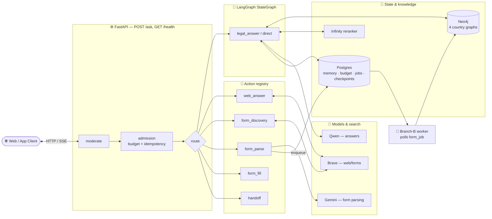
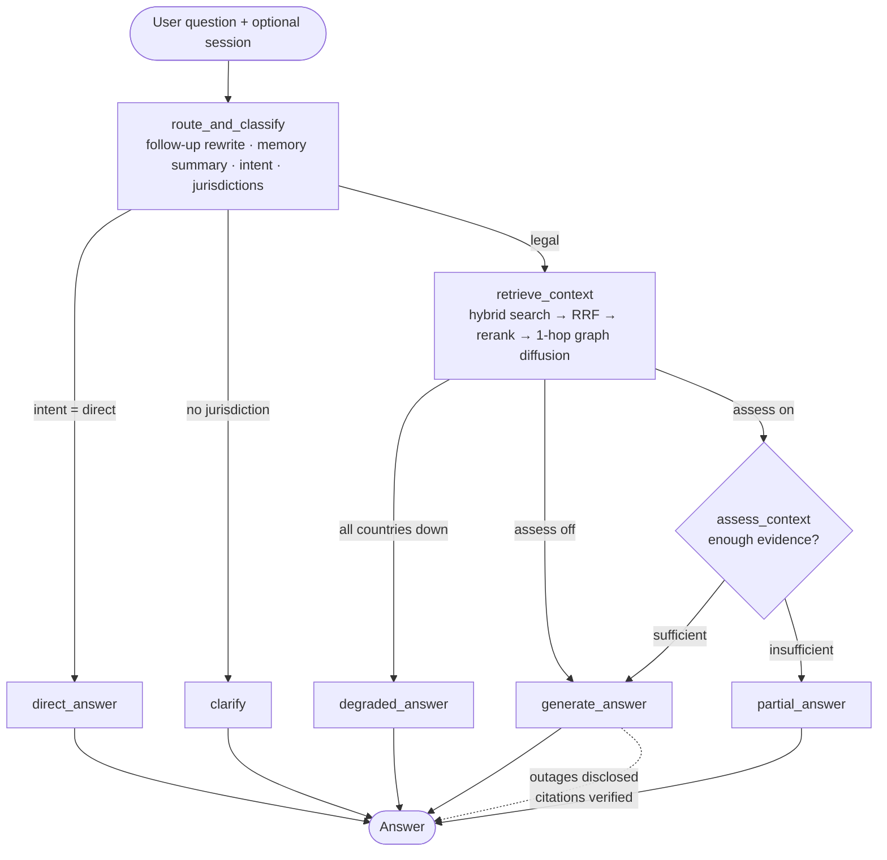
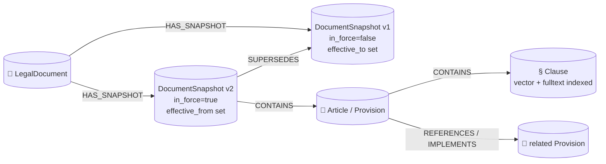
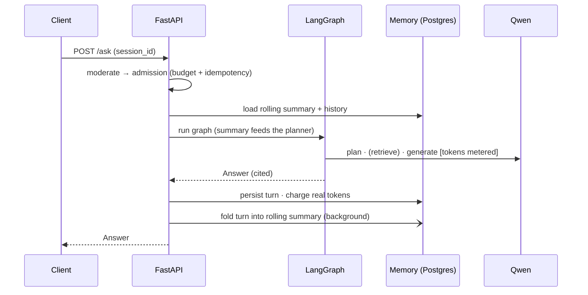
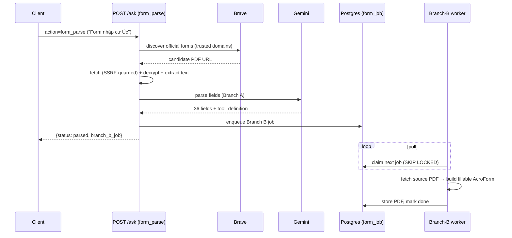

# AI-LP — Multi-Jurisdiction Legal Assistant

AI-LP answers legal questions about Vietnam, Japan, Korea, and Australia using a legal knowledge graph. It returns cited answers, supports follow-up questions, can search public web sources when legal retrieval has no usable coverage, and has explicit workflows for official forms and lawyer handoff.

The main workflow API is `POST /ask`. Other routes serve health checks, form-job artifacts, and a deterministic citation-graph compatibility operation.

## Capabilities

| Capability | Current behavior |
|---|---|
| Legal answers | Planner, hybrid legal retrieval, optional context assessment, answer generation, citation verification |
| Jurisdictions | `vn`, `jp`, `kr`, `au`; the client supplies the jurisdictions for legal retrieval |
| Follow-ups | Stores transcript and deterministic bounded memory; retrieves recent and lexically relevant earlier turns |
| Streaming | Server-Sent Events (SSE) for the legal-answer graph path |
| Web fallback | Uses Brave results when configured; output is marked `degraded` |
| Official forms | Discovers and verifies downloadable PDFs, parses fields, then queues PDF rendering |
| Form filling | Validates required values and queues filling of the verified source PDF |
| Lawyer handoff | Builds a draft from the authorized transcript without inferring facts or legal issues |
| Operations | Durable execution/idempotency, per-model-call token budgeting, health/readiness checks |

## Architecture




The API applies request validation, moderation, identity/session checks, and idempotency. Model calls go through `LiteLLMGateway`; legal retrieval goes through `GraphRetriever`; web search goes through `BraveSearch`. These adapters centralize their own behavior, but this is not a universal middleware boundary for every route: for example, `/extract-graph` is a deterministic compatibility route and does not use the `/ask` guardrail path.

## Legal answer flow



1. Validate the request, moderate the question, authenticate the caller, and bind the session to that principal.
2. Load deterministic memory and bounded transcript context.
3. Reserve an idempotent execution, then run the LangGraph workflow.
4. The planner resolves intent and language. Client-supplied `target_countries` are authoritative. If empty, the legal graph asks which jurisdiction applies; it does not silently use the planner's guess.
5. Retrieve by dense vector and full-text search, fuse and rerank results, then expand one graph hop.
6. If no usable legal evidence exists, try public web grounding when available. If context assessment is enabled and context is insufficient, use web grounding when available; otherwise return a partial answer.
7. Attach citation objects and a deterministic citation graph, persist the answer, and update memory.

Answer status values are `complete`, `partial`, `clarify`, and `degraded`. A web answer is marked `degraded` because it is public-source guidance, not an answer grounded in the legal graph. A country retrieval outage is surfaced as missing coverage.

## Legal graph and versioning



Each jurisdiction has its own Neo4j database. The schema uses versioned document snapshots containing provisions and clauses. Retrieval supports dense vector search, full-text search, reciprocal-rank fusion, reranking, and one-hop expansion over `REFERENCES` and `IMPLEMENTS`.

Indexes include provision_embedding and structural_embedding (vector), provision_fulltext (full-text), and snapshot_effective (temporal). Retrieval runs dense and full-text search, reciprocal-rank fusion, reranking, then one-hop expansion and bounded reranking of related provisions before score diffusion.

Pass as_of as an ISO date to retrieve the snapshot effective on that date. Without it, retrieval selects the current in-force snapshot. This setting is part of the idempotency hash.

## API

All JSON error responses use this shape:

```json
{"error":{"code":"invalid_request","detail":"...","retryable":false}}
```

Validation errors return HTTP 400. App errors map to HTTP statuses: forbidden 403, not found 404, conflict 409, quota exhausted 429, invalid model output 502, dependency unavailable 503, cancelled 499, and internal error 500.

### `POST /ask`

Request fields:

| Field | Type | Meaning |
|---|---|---|
| `question` | string, required | Non-blank; at most 20,000 characters |
| `target_countries` | string array | Optional jurisdiction codes; at most four |
| `session_id` | string or null | Continue a conversation; omitted creates a session |
| `as_of` | ISO date or null | Historical law snapshot date |
| `stream` | boolean | Stream the legal-answer graph result as SSE |
| `idempotency_key` | string or null | Retry key scoped to principal and canonical request body |
| `language` | string or null | Optional language override |
| `action` | route or null | Select an explicit workflow action |
| `resource` | object | Context for actions such as a chosen form or form values |

Unknown fields are rejected. `question` is limited to 20,000 characters, `target_countries` to four entries, and `resource` to 100 top-level fields. The whole request body is also limited by `MAX_REQUEST_BODY_BYTES` (default 2,000,000 bytes).

Example legal question:

```json
{
  "question": "What notice period applies?",
  "target_countries": ["vn"],
  "session_id": null,
  "as_of": null,
  "stream": false
}
```

Example explicit form parsing from a selected PDF:

    {
      "question": "Parse this official form",
      "target_countries": ["au"],
      "action": "form_parse",
      "resource": {
        "candidate": {
          "file_url": "https://agency.example/form.pdf",
          "form_name": "Application form"
        }
      }
    }

Example form filling (the actual field names and tool definition come from form_parse):

    {
      "question": "Fill the selected form",
      "target_countries": ["au"],
      "action": "form_fill",
      "resource": {
        "form_id": "application-123",
        "fields": [{"name": "full_name", "type": "text"}],
        "tool_definition": {
          "parameters": {"required": ["full_name"]}
        },
        "values": {"full_name": "Example Person"},
        "source_url": "https://agency.example/form.pdf"
      }
    }

After form_parse/form_fill returns a branch_b_job or job_id, poll GET /form-jobs/{job_id}; download when status is done.

Example explicit form discovery:

```json
{
  "question": "Find the official application form",
  "target_countries": ["au"],
  "action": "form_discovery",
  "resource": {}
}
```

Supported action names are `legal_answer`, `direct`, `web_answer`, `form_discovery`, `form_parse`, `form_fill`, and `handoff`. The explicit non-graph actions use the action registry. `legal_answer` and `direct` are handled by the legal-answer graph path; the planner still determines the result. Omitting `action` also uses that graph path.

Useful action resource fields currently used by the workflows:

- `form_parse`: optional `candidate`; a candidate is re-verified as a downloadable PDF.
- `form_fill`: `form_id`, `fields`, `tool_definition`, `values`, and verified-source URL in `file_url` or `source_url`.
- `handoff`: the API supplies transcript, citations, and missing information after checking session ownership.

Action responses are workflow-specific JSON. Form parsing returns a status, parsed fields, and a `branch_b_job` id. Form filling returns `need_input`, `invalid_selection`, `no_pdf_found`, or a queued `job_id`, depending on the request. See the workflow modules for the exact fields.

For `stream: true` on the graph path, the response is `text/event-stream`. Events contain text `delta` values followed by a final event shaped like `{"answer":{...},"done":true}`. Explicit action workflows return JSON; they do not stream through this path.

### Other routes

| Route | Purpose |
|---|---|
| `GET /health/live` | Process liveness only; does not check dependencies |
| `GET /health`, `GET /health/ready` | Readiness: Neo4j schema and, in durable mode, Postgres |
| `POST /extract-graph` | Legacy-compatible deterministic graph builder from caller-supplied citations/claims/sources; no LLM |
| `GET /form-jobs/{job_id}` | Read job state, after owner check |
| `GET /form-jobs/{job_id}/download` | Download completed PDF, after owner check |
| `GET /form-jobs/{job_id}/view` | View completed PDF inline, after owner check |

`/extract-graph` accepts at most 500 citations, 500 claims, and 100 web sources. It does not authenticate the caller or run `moderate()`; it only transforms the supplied data and does not call a model. The graph is also included in legal-answer responses, so clients using that result do not need the compatibility route.

Its request may include question (up to 20,000 characters) and answer (up to 50,000), but the current handler does not use those fields. The graph builder reads citation id/country/article_id/text/score/reached_from, claim text/evidence_ids, and web source uri or url/title. Example:

    {
      "citations": [{"id": "vn:v1:article-1:hash", "country": "vn", "article_id": "Article 1", "text": "Source text"}],
      "claims": [{"text": "Claim text", "evidence_ids": ["vn:v1:article-1:hash"]}],
      "web_sources": []
    }


## Identity and safety behavior

- With `AUTH_SECRET` configured, `POST /ask` and form-job routes require a bearer token signed as `principal_id.HMAC-SHA256(principal_id, AUTH_SECRET)`. `X-Principal-Id` is not accepted as authentication in this mode.
- Without AUTH_SECRET, the authentication helper falls back to open/development identity: bearer text, X-Principal-Id, or anon. The default create_app lifespan, including Compose, uses durable startup and refuses to start without AUTH_SECRET; the fallback applies only when development/in-memory serving is injected. Never expose open mode to an untrusted network.
- A session is bound to its first principal; later access by another principal is forbidden. Form-job reads also check the job owner.
- `moderate()` is a small English phrase denylist, not a security boundary or comprehensive safety classifier. It runs on `/ask` questions before model calls.
- Untrusted content is fenced in web-answer and form-parse/vision prompts. Legal generation and assessment prompts also tell the model to treat retrieved context as data, but retrieved legal text is not wrapped by `wrap_untrusted()`.
- Browser CORS origins are opt-in through comma-separated CORS_ALLOW_ORIGINS. The value is passed to Starlette as configured; there is no app-level check rejecting a wildcard, so configure explicit trusted origins.

## Memory and durable state



Production mode stores execution/idempotency, events, budget, conversation turns, memory, session ownership, form jobs, and LangGraph checkpoints in Postgres. Legal documents remain in Neo4j. The form worker claims queued jobs from Postgres.

Memory is deterministic, not LLM-summarized. It stores a bounded recent-turn window and preserved evidence references. Follow-up context combines a bounded recent transcript with earlier messages that share lexical terms with the new question. Defaults include five memory turns, a 2,000-character answer truncation threshold (with a visible marker appended), a 12,000-character follow-up context budget, and scanning at most 200 recent messages.

Idempotency keys are scoped to the principal and canonical request body. Repeating a completed request replays the saved response; using the same key with a changed body or another principal conflicts. Model tokens are reserved before each provider call and reconciled to reported usage when available. If the provider omits usage or the call fails, the reserved amount remains charged to the token ceiling; the usage counter logs a character-based estimate when usage is missing. This is quota accounting, not provider billing.

## Form workflows



Form discovery filters for official downloadable PDF candidates. Form parsing re-verifies a selected PDF, fetches and extracts it with SSRF checks, and asks the independently configured form parser model to identify fields. It then enqueues PDF rendering. Form fill checks required fields and mutually exclusive selections before enqueuing a fill job.

The worker fetches and verifies the source PDF, then fills existing AcroForm widgets or uses the vision-fill path for flat PDFs. Jobs have leases and capped attempts so abandoned work can be retried and poison jobs can fail. The client polls the form-job endpoints for status and downloads the result when complete. Online HTML forms are not handled by this flow.

## Local deployment

Requires Docker Compose. Copy `.env.example` to `.env`, set credentials and model endpoints, then:

```bash
docker compose up -d --build
curl -s http://localhost:12397/health/ready
```

Compose starts five services: API, form worker, Neo4j, Postgres, and Infinity. The development override mounts source and enables Uvicorn reload. For the non-reload deployment file, run `docker compose -f docker-compose.yml up -d --build`.

| Service | Host port |
|---|---:|
| API | 12397 → 8000 |
| Neo4j Bolt / Browser | 7688 / 7475 |
| Postgres | 5437 |
| Infinity | 7998 → 7997 |
| Form worker | internal |

The Compose file starts one API container and does not configure a load balancer or API replicas. The durable stores support shared state across processes, but this deployment is not a demonstrated multi-replica setup. Memory updates have a per-process lock, so concurrent turns for the same session across replicas can race. Circuit-breaker state is also per process.

## Configuration

Set values in `.env`; do not commit secrets.

| Variable | Purpose |
|---|---|
| `LLM_PROVIDER`, `LLM_TIMEOUT`, `QWEN_*`, `GEMINI_*` | Selected chat provider and endpoint; one provider/key, without automatic failover |
| `FORM_PARSE_MODEL`, `FORM_PARSE_BASE_URL`, `FORM_PARSE_API_KEY`, `FORM_PARSE_TIMEOUT` | Independent form parsing/vision model settings; current bootstrap requires these at app startup |
| `NEO4J_*`, `*_NEO4J_DB` | Neo4j connection and country databases |
| `*_EMBED_MODEL_NAME`, `*_EMBED_DIMENSION`, `*_RERANK_MODEL_NAME`, `INFINITY_API_URL` | Embedding and reranking services |
| `POSTGRES_*` or `DATABASE_URL` | Durable storage connection |
| `AUTH_SECRET` | Enables signed-bearer authentication and durable production startup |
| `TOKEN_BUDGET` | Per-principal token ceiling |
| `MAX_REQUEST_BODY_BYTES` | Request-body limit |
| `BRAVE_API_KEY` | Optional web and form search |
| `CORS_ALLOW_ORIGINS` | Allowed browser origins |
| `CONVERSATION_HISTORY_TURNS`, `MEMORY_MAX_REFS`, `MEMORY_TURN_CHARS` | Memory limits |
| `HISTORY_CHAR_BUDGET`, `HISTORY_SCAN_MESSAGES` | Follow-up transcript recall bounds |
| `FORM_JOB_LEASE_SECONDS`, `FORM_JOB_MAX_ATTEMPTS`, `FORM_WORKER_POLL_SECONDS` | Form worker lifecycle |

Retrieval and generation algorithm settings are defined as policy defaults in `src/config.py`, not all exposed as environment variables.

## Tests and live checks

Run unit/contract tests with `uv run pytest` and lint with `uv run ruff check src/`. Tests use fakes for application behavior; database and provider integration checks are separate. See [TESTING.md](./TESTING.md) for recorded live checks and examples. Treat recorded outputs and test totals as snapshots, not proof that the current deployment is healthy.
