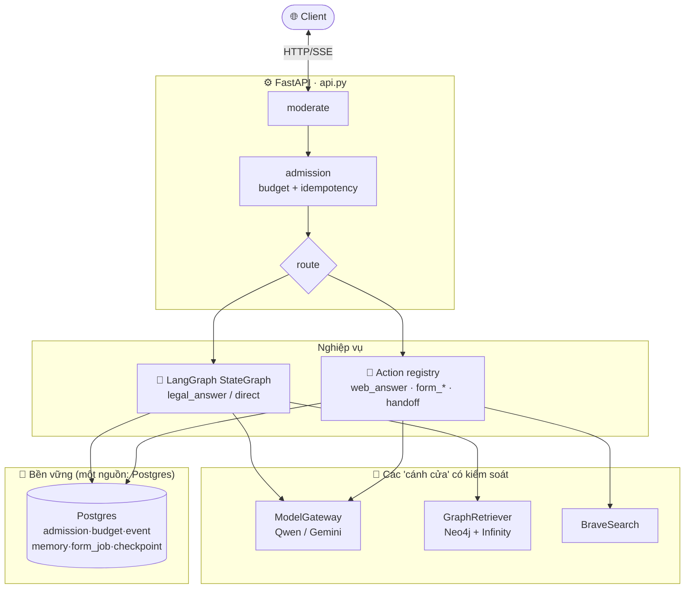
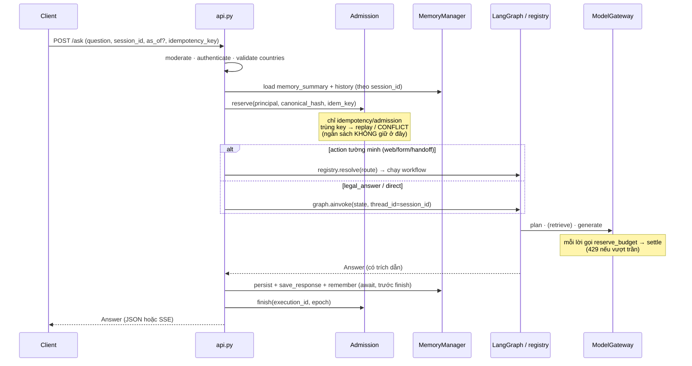
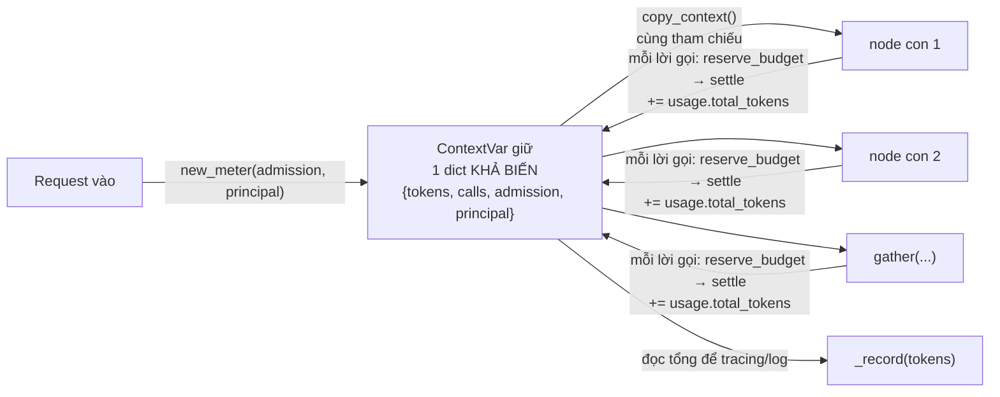
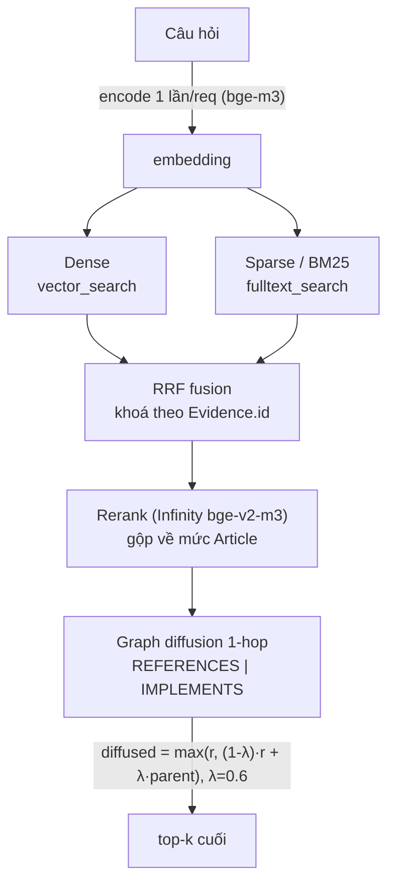
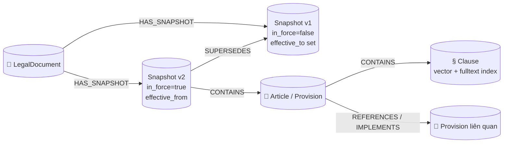
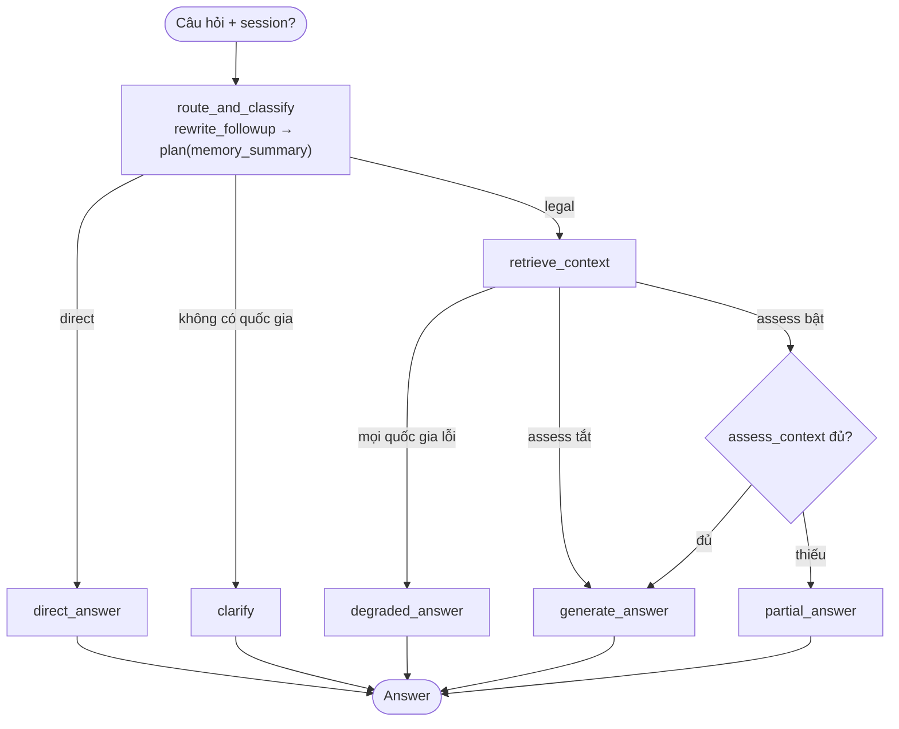
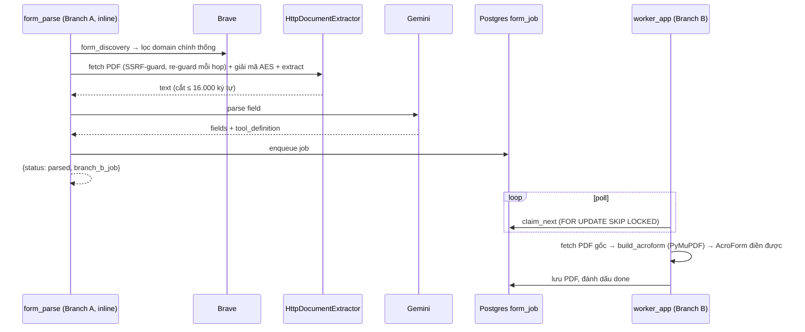

# Kiến trúc AI-LP: API, harness và workflows

Tài liệu này mô tả implementation hiện có trong src/. Khi hành vi trong tài liệu khác code, code là nguồn chuẩn. Đây là mô tả hệ thống hiện tại, không phải cam kết rằng guardrail thay thế được kiểm thử bảo mật hoặc chịu tải.

## 1. Phạm vi và kiến trúc

AI-LP có một endpoint workflow chính là POST /ask. FastAPI còn có các route vận hành và tương thích: health, form jobs, và /extract-graph. Vì vậy “một API workflow chính” không có nghĩa toàn ứng dụng chỉ có một URL.

- api.py: HTTP contracts, validation, auth, session ownership, request execution, JSON/SSE.
- bootstrap.py: lắp provider, retrieval, database và serving stores.
- harness/: gateway, token budget, execution lifecycle, lỗi, identity, health, tracing.
- routing/: planner cho câu hỏi tự do; registry cho action workflow tường minh.
- workflows/: legal answer, direct, web, forms và lawyer handoff.
- retrieval/: truy hồi luật từ Neo4j qua embedding/reranking.
- storage/postgres.py: adapter Postgres cho execution, history, memory, session ownership, token budget và jobs.

“Harness” ở đây là bộ adapter và điều phối quanh workflows; không phải mọi HTTP route đều đi qua cùng một middleware pipeline. /ask dùng moderation, identity, session ownership, admission và meter. /extract-graph chỉ dựng graph từ JSON caller gửi lên, không gọi LLM và không chạy các bước đó.

## 2. HTTP API

### 2.1 POST /ask

Request model là AskRequest trong src/api.py:

| Field | Quy tắc trong code |
|---|---|
| question | Bắt buộc, không rỗng sau khi trim, tối đa 20.000 ký tự |
| target_countries | Mặc định []; tối đa 4 mã; chỉ vn, jp, kr, au; chuẩn hóa lowercase |
| session_id | Tùy chọn; nếu bỏ trống, API tạo id mới |
| as_of | Tùy chọn ngày ISO, parse thành date |
| stream | Mặc định false; có hiệu lực với đường graph |
| idempotency_key | Tùy chọn; cùng principal/key/body sẽ replay kết quả đã lưu |
| language | Tùy chọn; nếu thiếu, phát hiện ngôn ngữ bằng hàm xác định |
| action | Enum Route hoặc null |
| resource | Object cho action; tối đa 100 trường cấp cao nhất |

Unknown fields bị từ chối. Middleware giới hạn body theo MAX_REQUEST_BODY_BYTES (mặc định 2.000.000 bytes); request vượt giới hạn nhận 413.

Luồng free-text không tin planner để tự chọn jurisdiction: caller cần truyền target_countries. Nếu danh sách rỗng, graph trả lời yêu cầu làm rõ và có thể đưa jurisdiction planner đoán như một gợi ý, nhưng không truy hồi theo gợi ý đó.

Các giá trị action được khai báo trong contracts.Route: legal_answer, direct, web_answer, form_discovery, form_parse, form_fill, handoff. Khi action null hoặc thuộc legal_answer/direct, API dùng LangGraph graph path. Planner trong graph vẫn phân loại câu hỏi; đặt action: direct không ép planner phải tạo direct answer. Các action khác được gọi qua registry và trả JSON workflow-specific.

resource được dùng như sau:

- form_parse: tùy chọn candidate đã chọn; workflow xác minh lại PDF trước khi parse.
- form_fill: dữ liệu form như form_id, fields, tool_definition, values, và URL nguồn PDF (file_url hoặc source_url). URL được xác minh lại.
- handoff: API tự chèn transcript, citations và thông tin còn thiếu sau khi kiểm tra owner của session; không tin các trường này từ client.
- Các action còn lại đọc query/countries/language và collaborator tương ứng; xem từng workflow nếu cần hợp đồng chi tiết.

Ví dụ hỏi pháp luật:

    {
      "question": "Thời hạn báo trước là bao lâu?",
      "target_countries": ["vn"],
      "stream": false
    }

Ví dụ discovery form:

    {
      "question": "Tìm mẫu đơn chính thức",
      "target_countries": ["au"],
      "action": "form_discovery",
      "resource": {}
    }

Legal answer trả object Answer: text, language, status, claims, missing, needs_form, form_candidates, route, legal_domain, needs_legal_answer, citations, graph, web_sources; API thêm session_id. graph là citation graph deterministic, đã được gắn trong answer nên UI thường không cần gọi /extract-graph.

Với stream: true trên graph path, response là SSE. Delta dùng {"delta":"..."}; kết thúc bằng {"answer":{...},"done":true}. Lỗi xảy ra sau khi stream bắt đầu được gửi thành SSE error object. Explicit action path hiện trả JSON, không dùng SSE stream.

### 2.2 Các route còn lại

| Route | Hành vi |
|---|---|
| GET /health/live | Liveness, không gọi dependency checks |
| GET /health, GET /health/ready | Readiness: Neo4j schema ở cả bốn DB; durable mode còn ping Postgres |
| POST /extract-graph | Tạo citation graph deterministic từ citations, claims, web_sources; không LLM |
| GET /form-jobs/{job_id} | Trả status/error/has_artifact sau owner check |
| GET /form-jobs/{job_id}/download | Tải PDF hoàn tất sau owner check |
| GET /form-jobs/{job_id}/view | Trả PDF inline sau owner check |

/extract-graph giữ tương thích với client cũ. Request giới hạn citations 500, claims 500, web sources 100. Route này hiện không xác thực principal, không moderation, và không rate-limit ở application code. Dữ liệu chỉ được chuyển qua build_graph(); không có model call.

Request còn nhận question (tối đa 20.000 ký tự) và answer (tối đa 50.000) nhưng handler hiện không dùng hai trường này. build_graph đọc id/country/article_id/text/score/reached_from từ citation, text/evidence_ids từ claim, và uri hoặc url/title từ web source.

### 2.3 HTTP errors

JSON lỗi chuẩn:

    {"error":{"code":"invalid_request","detail":"...","retryable":false}}

Pydantic request validation trả 400. AppError được map trong api.py:

| Code | HTTP |
|---|---:|
| invalid_request | 400 |
| forbidden | 403 |
| not_found | 404 |
| conflict | 409 |
| quota_exhausted | 429 |
| invalid_model_output | 502 |
| dependency_unavailable | 503 |
| cancelled | 499 |
| internal_error | 500 |

Request body quá giới hạn trả 413. Lỗi không xử lý khác trả 500 với detail rỗng.

## 3. Identity, guardrails và trust boundaries

### Identity

Khi AUTH_SECRET được cấu hình, durable startup yêu cầu bearer token. Token có dạng principal_id.HMAC-SHA256(principal_id, secret); API kiểm chữ ký constant-time. X-Principal-Id không được dùng làm xác thực trong mode này.

Khi không có secret, helper xác thực dùng fallback open/development: bearer string được dùng trực tiếp làm principal id; nếu không có bearer thì dùng X-Principal-Id hoặc anon. Tuy nhiên create_app mặc định khởi tạo durable serving và từ chối startup nếu thiếu AUTH_SECRET; fallback này chỉ dùng được khi inject development/in-memory serving. Đây không phải xác thực an toàn cho mạng không tin cậy. sign_principal() là helper trong code; hiện không có endpoint cấp token.

Session được claim cho principal đầu tiên. Request khác principal bị từ chối. Form-job routes kiểm owner trước khi trả trạng thái hoặc file.

### Safety

- moderate() là denylist nhỏ cho một số cụm tiếng Anh rõ ràng. Đây là pre-filter bổ trợ, không phải security boundary hay kiểm duyệt tổng quát.
- Moderation chạy trên question của /ask trước khi gọi model. Không áp dụng cho /extract-graph.
- wrap_untrusted() thêm fencing text cho nội dung web, form parse và vision form prompts. Legal generation/assessment prompts yêu cầu model coi retrieved context là dữ liệu, nhưng legal context không được bọc bằng helper đó. Đây là biện pháp prompt-level, không phải bảo đảm nội dung độc hại không thể ảnh hưởng model.
- Form source URL được xác minh và kiểm tra SSRF; redirect được theo thủ công và kiểm tra lại từng hop.
- resource là input do caller kiểm soát. Các workflow form xác minh lại URL/PDF và không tin cờ verified_pdf do client gửi.

### CORS và request size

CORS_ALLOW_ORIGINS là danh sách origin phân cách bằng dấu phẩy được chuyển cho Starlette. Nếu không cấu hình, middleware CORS không được thêm; code không có bước validate từ chối wildcard, nên cấu hình origin tin cậy rõ ràng. Body cap mặc định 2 MB; riêng các model request còn có giới hạn trường như trên.

## 4. Luồng xử lý /ask

1. Middleware giới hạn body; Pydantic kiểm tra schema.
2. moderate(question) chạy.
3. API dựng principal theo mode auth, chuẩn hóa countries, tạo hoặc claim session cho principal.
4. AdmissionService.reserve() nhận principal, canonical hash và idempotency key. Không có key thì sinh UUID mới.
5. API tải memory summary và transcript context (với graph path).
6. Graph path claim execution; explicit-action path resolve action qua RouteResolver và registry.
7. Trước mỗi lần gọi provider, gateway reserve token budget. Kết quả được settle theo usage thực nếu provider trả usage.
8. API lưu câu trả lời/transcript, response replay và hoàn tất execution. Với graph path, memory fold được await trước finish. Với action path, response được lưu và finish trước; memory fold chạy best-effort nền.
9. Trả JSON hoặc SSE.

### Idempotency và execution

Canonical hash bao gồm question, countries đã sort, action, resource, language, session và as_of. Hash không bao gồm cờ stream. Cùng principal + key + hash sẽ dùng cùng execution/response; body hoặc principal khác với cùng key gây conflict.

PgExecutionRepository lưu admission, execution, history, response và events trong Postgres. claim() tăng attempt epoch; finish/fail chỉ áp dụng với epoch hiện hành. Nếu cùng key đang chạy, request retry chưa có response nhận conflict retryable. Với in-memory adapter, idempotency mất sau restart và không chia sẻ giữa process.

Transcript persistence diễn ra trước finish; lỗi lưu transcript làm request fail dependency-unavailable. Memory update best-effort: lỗi được log và không làm hỏng response. Vì vậy transcript và memory không có cùng đảm bảo ghi bền vững.

## 5. Model gateway, token budget và resilience

LiteLLMGateway là adapter cho các OpenAI-compatible model endpoints. Chat provider được chọn bằng LLM_PROVIDER và dùng một model/key cụ thể; không có key rotation hay automatic provider failover. Form parsing có cấu hình model/base URL/API key độc lập.

Trước mỗi provider call, meter dành chỗ dựa trên UTF-8 prompt bytes + max output tokens + overhead; chat có cộng mức reserve cho ảnh. Nếu provider trả usage.total_tokens, budget được settle theo số đó. Nếu thiếu usage, budget giữ mức đã reserve; counter dùng để ghi log dùng ước tính theo ký tự. Call lỗi hoặc stream bị hủy thì code settle bằng mức đã reserve; vì chưa có usage thực, khoản reserve đó vẫn nằm trong token ceiling. Đây là quota accounting, không phải billing theo giá tiền.

PgBudget dùng một câu SQL có điều kiện để kiểm tra và cộng quota nguyên tử giữa các process. InMemoryBudget chỉ chia sẻ trong một process.

Gateway complete()/chat() có circuit breaker trong process: mở sau 5 lỗi liên tiếp, cho thử lại sau 30 giây. Stream path không gọi qua breaker trong implementation hiện tại. Health readiness không probe provider/Infinity; các dependency này được phát hiện khi sử dụng.

## 6. Legal-answer graph và retrieval

route_and_classify gọi planner. Nếu có transcript history, planner thử rewrite follow-up; lỗi hoặc rewrite không giữ được chủ đề sẽ fallback về câu gốc. Planner trả intent, language, jurisdictions, subqueries, missing-information và needs_form.

Client countries là authoritative. Rỗng thì graph đi nhánh clarify, không lấy country planner đoán. Với legal retrieval, mỗi subquery (tối đa GenerationPolicy.max_subqueries, mặc định 4) được truy hồi; kết quả được hợp nhất và cắt theo context budget. Có per-country floor: nếu nhiều quốc gia cùng có evidence, tổng có thể vượt budget một chút để giữ ít nhất passage tốt nhất của mỗi nước.

GraphRetriever chia việc theo jurisdiction; lỗi một country trở thành UNAVAILABLE thay vì làm hỏng tất cả. Đường retrieval gồm:

1. Embed query một lần.
2. Dense vector search và full-text search.
3. Reciprocal-rank fusion theo evidence id.
4. Rerank candidates.
5. Mở rộng một hop theo REFERENCES/IMPLEMENTS và khuếch tán điểm theo policy.

as_of chọn snapshot có hiệu lực tại ngày đó; nếu null, dùng snapshot in_force.

### Snapshot versioning

Generation tạo claims từ citation markers; code chỉ giữ evidence IDs có trong retrieved evidence. Câu không có citation hợp lệ khiến trạng thái không thể là complete. Khi retrieval thiếu coverage, web fallback có thể trả lời từ Brave sources và luôn đánh dấu degraded.

Legal response chứa citation objects có source text và graph nodes/edges; graph tạo deterministic trong graph_view.py, không gọi model.

### StateGraph control flow

## 7. Explicit actions

| Action | Hành vi theo workflow |
|---|---|
| web_answer | Tìm Brave sources nếu provider có cấu hình; trả Answer trạng thái degraded |
| form_discovery | Tìm candidates theo country và chỉ trả downloadable PDF đã xác minh |
| form_parse | Xác minh PDF, trích nội dung, parse fields bằng form model, enqueue rendering job |
| form_fill | Kiểm required fields và mutually exclusive groups; enqueue fill job |
| handoff | Tạo draft xác định từ session transcript, citations và missing info; không gọi LLM |
| direct | Trong action registry thì planner tạo direct answer; qua HTTP /ask, giá trị này dùng graph path |

Form parse chỉ hỗ trợ downloadable PDF, không xử lý online HTML forms. Form filling đòi hỏi source PDF đã xác minh. API không coi artifact là xong cho tới khi worker đánh dấu job done; client poll /form-jobs/{id} rồi tải PDF.

## 8. Form pipeline và worker

Branch A (trong request): discovery/verification, SSRF-guarded PDF fetch, text extraction và LLM field parsing. Text được chia chunk theo config. Branch B (ngoài request): Postgres form_job queue được worker poll; FOR UPDATE SKIP LOCKED claim job và lease cho phép reclaim sau worker crash. Attempts bị giới hạn.

Worker dùng PDF gốc. PDF có AcroForm thì fill widget hiện có. PDF phẳng đi qua vision-fill: geometry tìm vùng, vision model map field sang vùng, rồi renderer ghi giá trị. Các trường không map được an toàn có thể làm job fail để review. Giá trị đến từ caller; model vision chỉ map field/vùng.

Worker là process riêng chạy python -m src.worker_app; Compose dùng chung image app. Hàng đợi Postgres chia sẻ được giữa nhiều worker, nhưng Compose hiện chỉ khai báo một worker.

## 9. Memory và stores

Production memory dùng PgLongTermStore trong ai_thread_states. Đây không phải LLM summary:

- Lưu tối đa CONVERSATION_HISTORY_TURNS turns (mặc định 5).
- Cắt assistant text mỗi turn tại MEMORY_TURN_CHARS (mặc định 2.000 ký tự) rồi thêm marker báo cắt.
- Giữ tối đa MEMORY_MAX_REFS references (mặc định 40).
- Render các turns thành context text; không gọi model để nén/tóm tắt.
- Follow-up đọc transcript gần đây, mặc định tối đa 200 messages, giữ recent context cộng các message cũ có từ khóa trùng câu hỏi, trong HISTORY_CHAR_BUDGET mặc định 12.000 ký tự; message mới nhất luôn được giữ nên tổng có thể vượt budget nếu riêng message đó đã dài hơn mức cho phép.

Keyword recall là lexical, không semantic. Một follow-up không dùng lại từ/cụm nào trong fact cũ có thể không kéo fact đó vào context. Memory manager có lock trong process cho read-modify-write, không phải distributed lock; cùng session update đồng thời ở nhiều API replica có thể lost update.

Stores production trong Postgres gồm execution/admission/response/events, token budget, transcript/evidence snapshot, session owner, memory và form jobs. LangGraph checkpoint cũng ở Postgres nhưng dùng pool psycopg riêng. Neo4j giữ legal graph và snapshots.

## 10. Errors, health và tracing

/health/live chỉ cho biết process còn sống. /health và /health/ready kiểm tra schema labels/vector indexes trên cả bốn Neo4j DBs; production còn ping Postgres. Infinity và model providers không được kiểm tra tại readiness.

LangSmithTracer tạo span khi LangSmith có trong môi trường; nếu thiếu thì no-op. Span attributes được đặt ở execution id/route, không truyền question/session content trong các span call site hiện có. Đây không thay thế metrics hoặc distributed tracing đầy đủ.

## 11. Configuration và deployment

Các biến cài đặt chính được liệt kê trong .env.example:

- Model chat: LLM_PROVIDER, LLM_TIMEOUT, và nhóm provider *_MODEL, *_BASE_URL, *_API_KEY.
- Form model độc lập: FORM_PARSE_MODEL, FORM_PARSE_BASE_URL, FORM_PARSE_API_KEY; bootstrap hiện tạo gateway này ngay khi dựng deps, nên thiếu biến làm app startup lỗi rõ ràng.
- Neo4j: NEO4J_* và VI_NEO4J_DB, JP_NEO4J_DB, KR_NEO4J_DB, AU_NEO4J_DB.
- Infinity: INFINITY_API_URL cùng embed/rerank model settings.
- Postgres: DATABASE_URL hoặc POSTGRES_*.
- Auth, quotas, request size, memory/history và worker lease: xem .env.example.

docker-compose.yml chạy API, worker, Neo4j, Postgres và Infinity. docker-compose.override.yml là dev overlay với source mount và reload. Compose production file hiện cấu hình một app container, cổng host cố định và không có load balancer.

Durable adapters cho execution, budget, transcript, session ownership, jobs và checkpoint đã dùng Postgres nên có thể chia sẻ giữa process. Điều đó chưa chứng minh deployment scale-out: circuit breaker và memory-update lock vẫn per-process; retrieval/model/GPU/Postgres capacity cũng giới hạn tổng tải. Hiện không có load-test result trong docs được coi là xác nhận scaling.

## 12. Tests và tài liệu vận hành

Unit/contract suites nằm trong tests/; kiểm tra live và curl examples nằm trong TESTING.md. Không ghi số test cố định ở đây vì số lượng thay đổi theo branch/dependency. Các integration checks cần database, model/search credentials hoặc GPU không tương đương với unit tests dùng fake.

Tài liệu nên được đối chiếu định kỳ với:
- API schemas/routes: src/api.py
- Workflow contract: src/contracts.py và src/workflows/
- Defaults/environment: src/config.py và .env.example
- Production stores: src/bootstrap.py và src/storage/postgres.py
- Deployment: docker-compose.yml và docker-compose.override.yml
